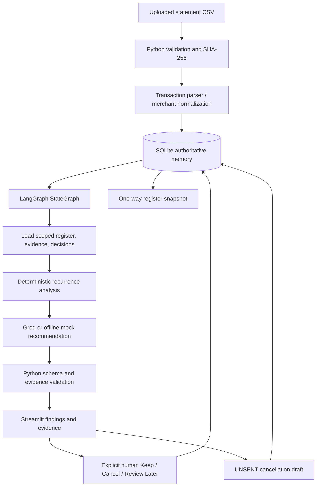

# Architecture

## Trust boundaries

1. CSV values, descriptions and memo fields are untrusted data.
2. The LLM sees evidence as data and returns a bounded JSON recommendation.
3. Python validates action names and evidence references. Invalid results become escalation.
4. The user, not the model, approves subscription decisions.
5. No external action executor exists. Cancellation drafts are local text only.

## Components

- Streamlit: presentation and explicit approval controls.
- `subbill.tools`: parsing, normalization, detection, evidence, decisions, correction versioning and drafts.
- `subbill.graph`: LangGraph orchestration and memory retrieval.
- `subbill.llm`: Groq SDK adapter and deterministic mock.
- `subbill.db`: SQLite schema and per-user data access.
- `subbill.export`: read-only CSV/JSON snapshots.
