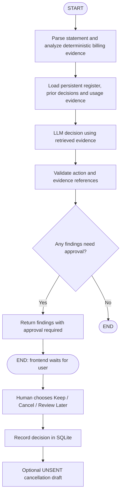

# LangGraph workflow

The currently implemented compiled graph uses LangGraph `StateGraph` with `START`, four named nodes (`parse_statement`, `load_persistent_memory`, `analyze_and_decide`, `awaiting_human_approval`), explicit edges, a conditional route based on whether findings need approval, and `END`. The user approval step is intentionally outside the graph so the model cannot approve itself or execute a cancellation. The frontend writes the user's decision to SQLite after explicit interaction. `review()` raises a clear dependency error if LangGraph is not installed; it does not silently substitute a fake graph.
