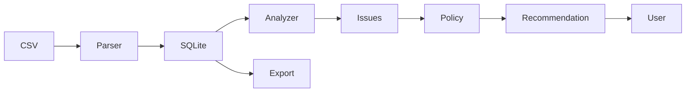

# Evaluation report

## Summary

Subbill is a local, CPU-compatible assistant that keeps the authoritative
register in SQLite. Parsing and issue detection are deterministic; the model
only recommends a bounded action. This prevents untrusted statement text from
changing permissions or causing side effects.

## Architecture

The register is populated from the first observed recurring merchant. Later
cycles compare amount and decisions against current memory. Re-ingestion is
deduplicated by SHA-256 and exports are one-way.

## Reproducible evaluation

Run `pytest`, `python -m subbill.run_scenarios`, `python -m subbill.ablation`,
and `python -m subbill.metrics`. The generated files in `results/` are the
evidence for the run. The offline mock is used for reproducibility; a real
provider run must be performed with the student's own credential before
claiming provider latency or token measurements.

## Limitations

The current submission intentionally keeps provider integration offline and
does not perform external actions. It uses simple merchant aliases and
monthly inference, so a production system would need richer normalization,
provider adapters, and stronger date interval inference.
